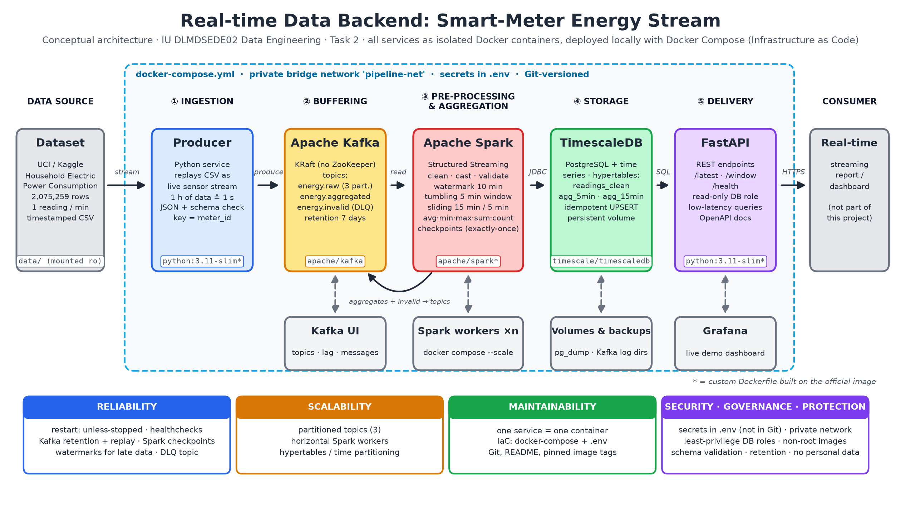

# Real-time data backend for streaming smart-meter energy data

Portfolio project for **IU Project: Data Engineering (DLMDSEDE02), Task 2**: a reproducible,
containerised streaming backend that ingests, validates, aggregates and delivers more than
two million time-stamped smart-meter readings in real time.



| Stage | Microservice | Image | What it does |
|---|---|---|---|
| Ingestion | `producer` | `python:3.11-slim` + own code | Replays the UCI data set as a live stream (default 1 hour of data per second = 60 events/s), pseudonymous meter IDs, late-event simulation |
| Buffer | `kafka` (+ `kafka-init`) | `apache/kafka:3.9.0` (KRaft) | Topics `energy.raw` (3 partitions), `energy.aggregated`, `energy.invalid` (dead-letter), 7-day retention |
| Processing | `spark-master`, `spark-worker`, `spark-job` | `apache/spark:3.5.3` + Kafka connector JARs | Structured Streaming: parse, validate, event-time windows with 10-min watermark |
| Storage | `timescaledb` | `timescale/timescaledb:2.17.2-pg16` | Hypertables for readings and window results, idempotent upserts |
| Delivery | `api` | `python:3.11-slim` + FastAPI | REST endpoints for the report, read-only DB role |
| Monitoring | `kafka-ui`, `grafana` | `provectuslabs/kafka-ui`, `grafana/grafana` | Topic lag and messages; live dashboard |

## Quick start

Requirements: Docker Desktop (or Docker Engine + Compose v2), about 6 GB free RAM for Docker, 2 GB disk.

```bash
git clone <this repository>
cd realtime-energy-pipeline
cp .env.example .env          # then change the passwords in .env
docker compose up -d --build  # first start downloads images and the data set (a few minutes)
docker compose ps             # all services "running"/"healthy", kafka-init "exited (0)"
python scripts/check_pipeline.py
```

| URL | Service |
|---|---|
| http://localhost:8000/docs | REST API (Swagger UI) |
| http://localhost:3000 | Grafana dashboard *Smart-meter energy stream* (login from `.env`) |
| http://localhost:8080 | Kafka UI (topics, partitions, consumer lag, messages) |
| http://localhost:8081 | Spark master UI (workers) |
| http://localhost:4040 | Spark application UI (streaming queries, batch durations) |

All ports are bound to `127.0.0.1` only; Kafka and the database are reachable only inside the
private Docker network `pipeline-net`.

## Data flow

1. **producer** reads `data/household_power_consumption.txt`, turns every line into a JSON event
   (`meter_id`, `ts`, 7 measurements) and sends it to `energy.raw` with the meter ID as key
   (ordering per meter). Structurally broken lines go to `energy.invalid`. The position in the
   file is stored in a volume, so a restart does not resend old events.
2. **spark-job** reads `energy.raw` and runs six streaming queries (each with its own checkpoint):

   | Query | Logic | Sink |
   |---|---|---|
   | `dlq` | missing values, voltage outside 200 to 260 V, negative values | Kafka `energy.invalid` |
   | `readings` | valid, typed readings | `energy.readings` (insert, ignore duplicates) |
   | `agg_5min` | tumbling 5 min: avg/min/max power and voltage, sum of sub-meters, count | `energy.agg_5min` + Kafka `energy.aggregated` |
   | `agg_15min` | sliding 15 min, slide 5 min: avg power, max current | `energy.agg_15min` |
   | `agg_daily` | tumbling 24 h: energy in kWh and share per sub-meter | `energy.agg_daily` |
   | `quality_5min` | valid vs. invalid readings per 5 min | `energy.quality_5min` |

   All windows use **event time** with a **10-minute watermark**; late events inside the watermark
   update the window (output mode *update* + upsert).
3. **api** serves the results: `/latest`, `/windows?meter_id=...&size=5min|15min|daily`, `/quality`,
   `/meters`, `/stats`, `/health`.

## Demonstrations

```bash
# Scale out: more simulated households and more processing capacity
docker compose up -d --scale producer=3 --scale spark-worker=2

# Manual change becomes visible in the aggregates within seconds (meter "m-manual",
# event time = newest time in the stream, so the window is still open)
docker compose exec producer python inject_event.py --power 9.5
curl "http://localhost:8000/latest?meter_id=m-manual"
docker compose exec producer python inject_event.py --voltage 999   # -> dead-letter topic
# or append a line to data/household_power_consumption.txt (FOLLOW=true picks it up)

# Reliability: stop/restart processing and broker while data flows, then check for duplicates
bash scripts/failure_test.sh

# End-to-end latency: manual event sent to Kafka until visible in the API
python scripts/measure_latency.py --runs 8

# Logs
docker compose logs -f producer spark-job
```

## Test results (local run, 24 Oct 2026)

Windows 11 laptop, Docker Desktop 4.96 (WSL 2, 8 GB for Docker), whole stack about 3.5 GB RAM.

| Test | Result |
|---|---|
| Start from scratch with `docker compose up -d --build` | all 10 services up, data set downloaded automatically |
| Throughput | 60 events/s per producer; 3 producers about 230 events/s incl. catch-up |
| Correctness | 25,759 closed 5-min windows recomputed from `energy.readings` in SQL: 0 differences |
| Duplicates | 0 duplicate readings, also after the failure test |
| Failure test (`scripts/failure_test.sh`): Spark job stopped 30 s, Kafka restarted | processing resumed from checkpoints, no data lost, 0 duplicates |
| Scaling `--scale producer=3 --scale spark-worker=2` | new meters join at the current stream time, both workers used |
| Manual change (`inject_event.py`) | new value visible in `/latest` after one trigger (5 s) |
| End-to-end latency (`scripts/measure_latency.py`, 8 runs) | min 2.1 s, mean 5.5 s, max 9.1 s |
| Invalid data | rows with `?` and voltage 999 V in `energy.invalid` with reason |
| Least privilege | `report_reader` gets "permission denied" on INSERT |

## Configuration

All settings live in `.env` (template: `.env.example`), for example `SPEEDUP` (0 = as fast as
possible), `MAX_EVENTS`, `LATE_EVENT_RATE`, `WATERMARK`, `TRIGGER_SECONDS`, `VOLTAGE_MIN/MAX`,
`SPARK_WORKER_CORES/MEMORY`, `JOIN_STREAM_TIME`, `API_KEY` (enables the `X-API-Key` header check).

## How the requirements are met

| Requirement | Implementation |
|---|---|
| Reliability | Kafka retention (replay), Spark checkpoints, idempotent upserts, producer position file, `acks=all` + idempotent producer, health checks, `restart: unless-stopped`, dead-letter topic |
| Scalability | 3 partitions keyed by meter, `--scale spark-worker=n`, `--scale producer=n`, TimescaleDB hypertables (time partitioning) |
| Maintainability | One task per container, Infrastructure as Code (`docker-compose.yml`), configuration in `.env`, pinned image versions, unit tests, provisioned dashboards |
| Security | Secrets only in `.env` (git-ignored), private network, ports bound to localhost, non-root containers, least-privilege DB roles (`spark_writer`, `report_reader`, read-only transactions in the API), optional API key |
| Governance | Versioned JSON schema (`schema_version`), validation with reasons, dead-letter topic, lineage raw → readings → windows, table comments, quality metrics |
| Data protection | Pseudonymous meter IDs (salted SHA-256), only aggregates delivered to the report, retention policies prepared in `db/init/01-init.sh` |

## Project structure

```
├── docker-compose.yml        # the whole system (IaC)
├── .env.example              # configuration template
├── kafka/create-topics.sh    # topic creation (kafka-init)
├── producer/                 # ingestion service + unit tests
├── spark/                    # streaming job (stream_job.py) and upsert sinks (sinks.py)
├── db/init/01-init.sh        # schema, hypertables, roles
├── api/                      # FastAPI delivery service
├── grafana/                  # provisioned data source and dashboard
├── scripts/                  # download, end-to-end check, failure test, latency measurement
└── data/                     # data set (downloaded, not in Git)
```

## Tests

```bash
pip install pytest
python -m pytest producer/tests
```

## Troubleshooting

- **Containers restart / out of memory:** give Docker at least 6 GB (Docker Desktop → Settings →
  Resources) or reduce `SPARK_WORKER_MEMORY`.
- **Grafana shows no data:** the data set is from 2006 to 2010; the dashboard opens at
  16 to 20 Dec 2006. Change the time range to the period being replayed.
- **Data download fails (Linux, permission):** run `python scripts/download_data.py` on the host
  or `chmod 777 data`.
- **Start from scratch:** `docker compose down -v` deletes all volumes (Kafka log, database,
  checkpoints, producer position).

## Limitations

Single Kafka broker (replication factor 1) to fit a 16 GB laptop; no TLS/SASL between services;
events older than the watermark are dropped by Spark (counted only via the late-event setting).
These points are discussed in the project report.
